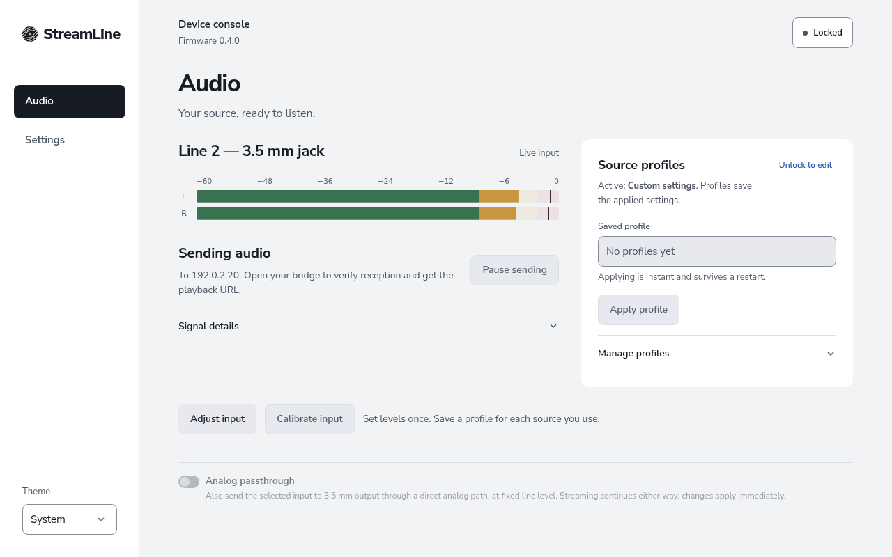
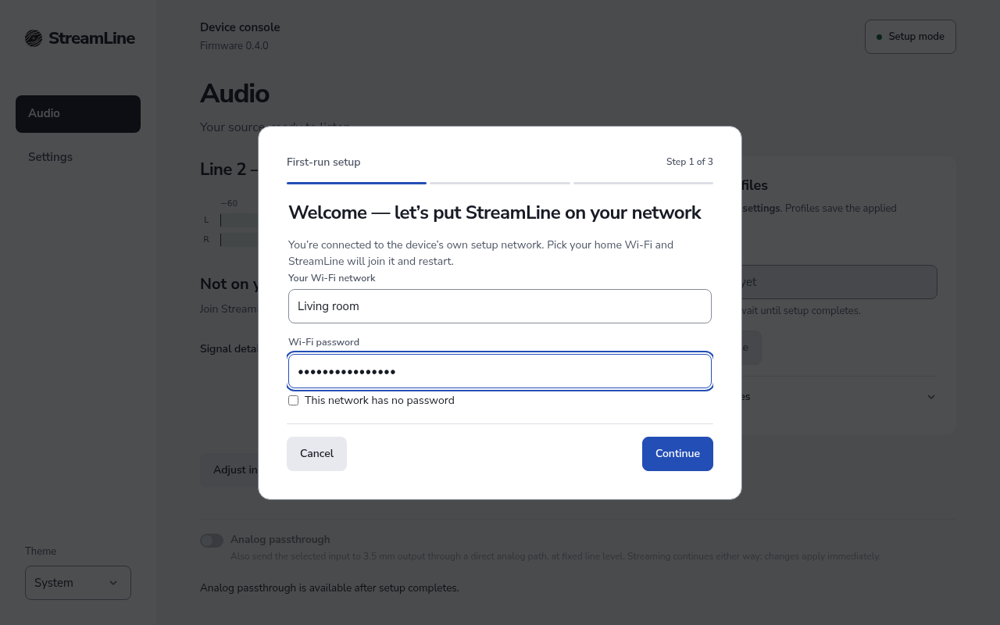
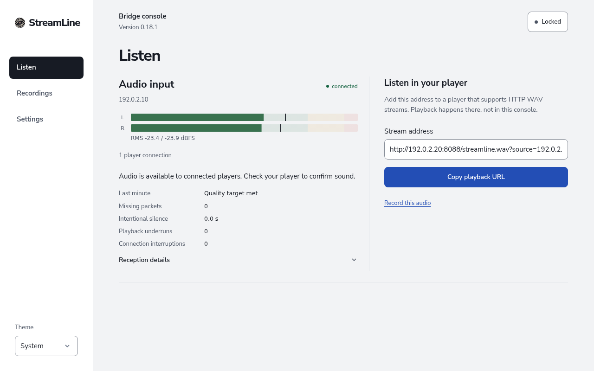
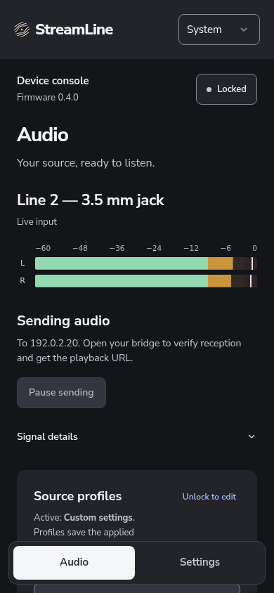

# ESP32 StreamLine

Turns an ESP32 audio board into a network source for your turntable or CD deck. The board captures its line input and sends raw PCM over Wi-Fi to a small self-hosted bridge, which hands every source to Music Assistant as a Live Input and serves it as a live WAV stream for anything else. The device stays dumb on purpose: encoding, buffering and playback belong to the bridge and the players. Firmware in Rust on ESP-IDF, the bridge in Python, and a Preact console the device serves itself.

- Sets up from a phone: the board opens its own setup network, and its console joins your Wi-Fi and finds the bridge
- Shows up in Music Assistant as a Live Input, and can start playing when a record starts
- Live HTTP WAV for Snapcast, Icecast or any other player, plus lossless recordings
- Pauses on silence and resumes on the same connection when the music starts
- Can play the input through the board's own output while it streams
- Source profiles per deck, switched live from the console or the API
- Optional TLS 1.3 for the audio, with a key per device and forward secrecy
- Signed OTA updates from GitHub releases, rolled back if an image fails to boot
- Everything the console does is an HTTP API first ([OpenAPI](docs/openapi.json)), so scripts and agents can drive the device without a browser

How it works under the hood: [design notes](docs/design.md) and [architecture](docs/architecture.md).

## Screenshots









## Hardware

The official preset is the Ai-Thinker ESP32 Audio Kit v2.2 with its ES8388 codec. A board needs 4 MB of flash and an ESP32 rev 3.0 (ECO3) or later, because signed firmware uses the RSA scheme earlier revisions lack. Other boards with a supported codec run from a JSON [board descriptor](docs/design.md#board-support), which also maps their [LEDs](docs/design.md#leds) and [buttons](docs/design.md#buttons).

## Quick start

### 1. Flash the board

Open the [WebFlasher](https://lutyjj.github.io/esp32-streamline/) in desktop Chrome, Edge, or Firefox 151 or newer, connect the board over USB, and click **Connect & install**. From a terminal, download `streamline-X.Y.Z-full.bin` from [Releases](https://github.com/lutyjj/esp32-streamline/releases) and flash it with [esptool](https://docs.espressif.com/projects/esptool/):

```sh
esptool.py -p /dev/ttyUSB0 -b 460800 write_flash 0x0 streamline-X.Y.Z-full.bin
```

Adjust `-p` to your port: `/dev/cu.usbserial-0001` on macOS, `COM3` on Windows.

### 2. Run the bridge

**Home Assistant:** go to **Settings → Apps → Install app**, open the three-dot menu, choose **Repositories**, and add `https://github.com/lutyjj/esp32-streamline`. Then install **ESP32 StreamLine Bridge** and start it.

**Docker:** save this as `docker-compose.yml` and run `docker compose up -d`:

```yaml
services:
  streamline-http:
    image: ghcr.io/lutyjj/esp32-streamline-bridge:latest
    restart: unless-stopped
    network_mode: host
    environment:
      STREAMLINE_SOURCE_ALLOW: ${STREAMLINE_SOURCE_ALLOW:-}
      STREAMLINE_RECORDINGS_DIR: ${STREAMLINE_RECORDINGS_DIR:-}
      STREAMLINE_API_TOKEN: ${STREAMLINE_API_TOKEN:-}
    command:
      - --transport-state-file
      - /data/transport.json
      - --sendspin-state-dir
      - /data/sendspin
      - --sendspin-server-url
      - ${STREAMLINE_SENDSPIN_SERVER_URL:-}
    read_only: true
    security_opt:
      - no-new-privileges:true
    cap_drop:
      - ALL
    tmpfs:
      - /tmp
    volumes:
      - streamline-recordings:/recordings
      - streamline-transport:/data

volumes:
  streamline-recordings:
  streamline-transport:
```

Host networking lets devices [discover the bridge](docs/bridge.md#discovery) during setup, and it needs Docker Engine on Linux. On Docker Desktop, publish `39000:39000/tcp` and `8088:8088/tcp` instead and type the bridge's address on the device.

### 3. Set up the device

1. Read the setup network's name and password from the WebFlasher's **Logs & console** (or `espflash monitor`); the board prints both when it starts. No password at hand? Hold KEY1 while plugging the board in, and the setup network starts open for that one boot.
2. Join `esp32-streamline-XXXX`. The setup console opens by itself, or at `http://192.168.71.1/`.
3. Enter your Wi-Fi and **save the admin key** it generates. The device shows it once, every later settings change needs it, and losing it means a reflash.
4. After the reboot, open `http://streamline-xxxx.local/` (or the device's IP if your network drops mDNS), pick the bridge under **Bridge**, and set levels under **Audio**.

The stream is then live at `http://<bridge-host>:8088/streamline.wav`. To play it in Music Assistant, open the source under **Sources** in the bridge console, make a pairing token there, and paste it into the source's setup there; [Music Assistant live inputs](docs/bridge.md#music-assistant-live-inputs) covers the rest.

Updates install daily once the audio goes idle, and **Maintenance → Updates** changes that. See [OTA updates](docs/ota.md).

## Configuration

Compose reads these from your shell or a `.env` file beside it. The Home Assistant app has matching options on its configuration page.

| Variable | Sets |
|---|---|
| `STREAMLINE_SENDSPIN_SERVER_URL` | Music Assistant's Sendspin server, such as `ws://<host>:8927/sendspin`, to publish every source as a Live Input |
| `STREAMLINE_API_TOKEN` | Bridge API token, at least 16 characters; Music Assistant and recordings need it |
| `STREAMLINE_RECORDINGS_DIR` | `/recordings` turns on [lossless recordings](docs/recordings.md) |
| `STREAMLINE_SOURCE_ALLOW` | Device IPv4 addresses allowed to stream, comma-separated |

Every other bridge option is in the [bridge reference](docs/bridge.md#tuning-options).

## Security

The device and the bridge speak plain HTTP and belong on a trusted LAN; read the [security notes](docs/security.md) before exposing a port. The audio is cleartext until you [turn on encryption](docs/tcp-transport.md#enable-encryption), a short coordinated switch between device and bridge.

## Development

Everything builds and checks in containers, so you need Docker or Podman and `make`. [CONTRIBUTING.md](CONTRIBUTING.md) covers setup, flashing and releases, and [AGENTS.md](AGENTS.md) holds the engineering rules for people and agents alike.

## License

[GPL-3.0-or-later](LICENSE)
